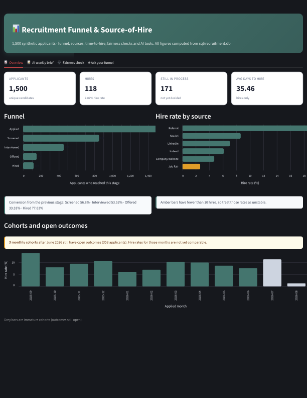
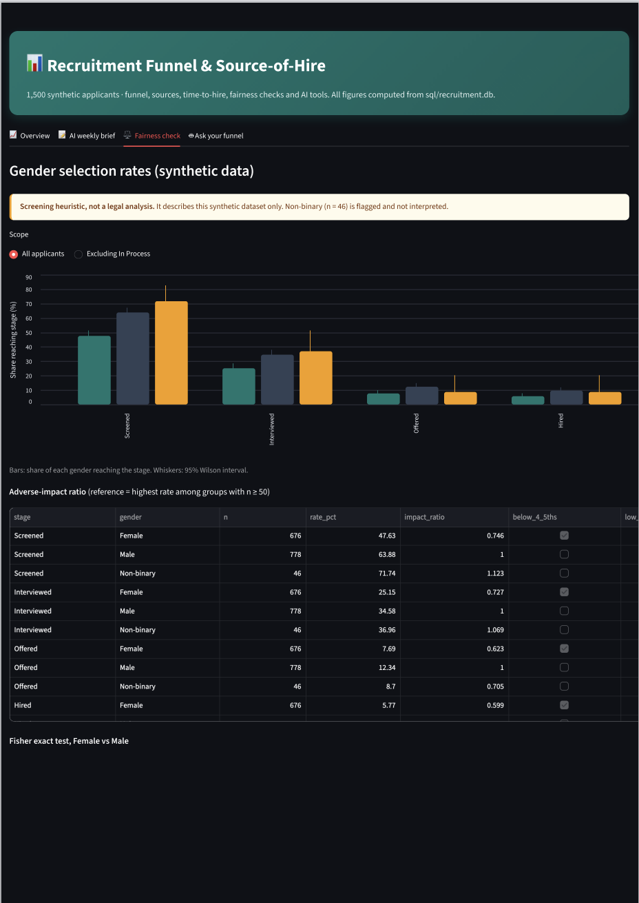
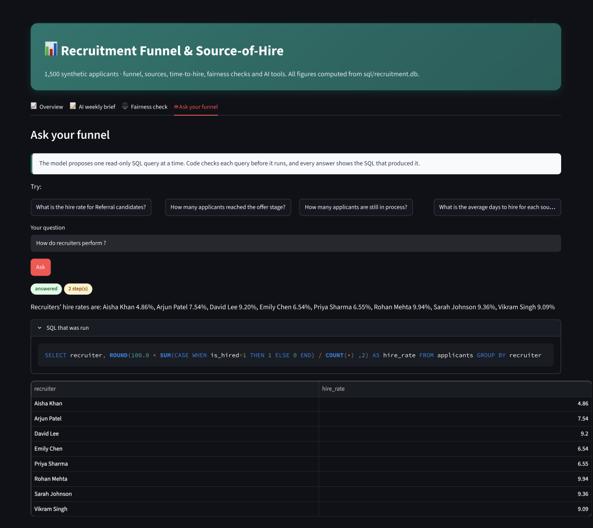
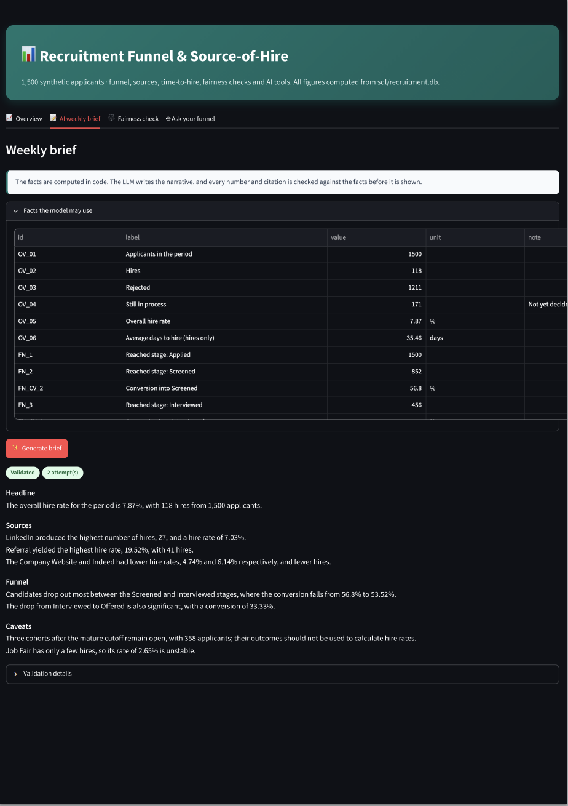
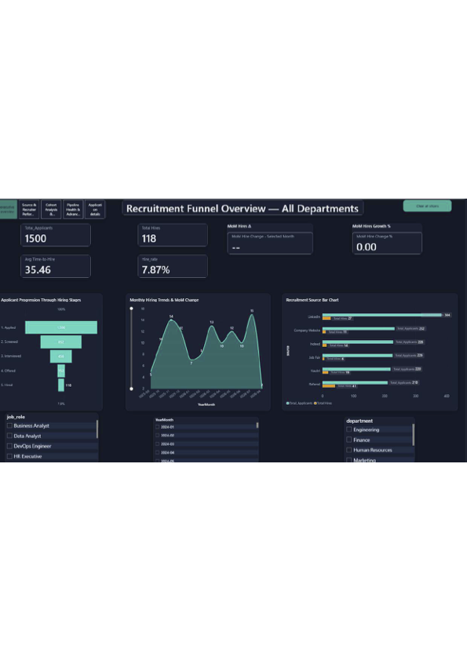
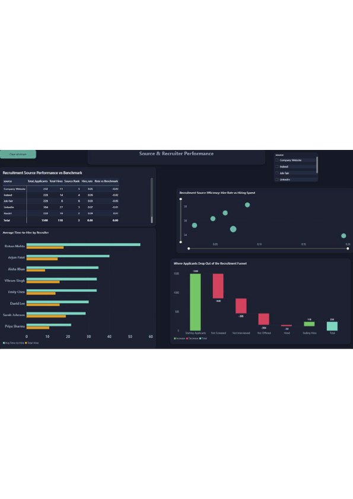
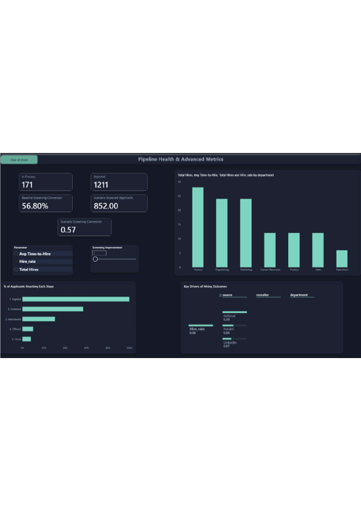
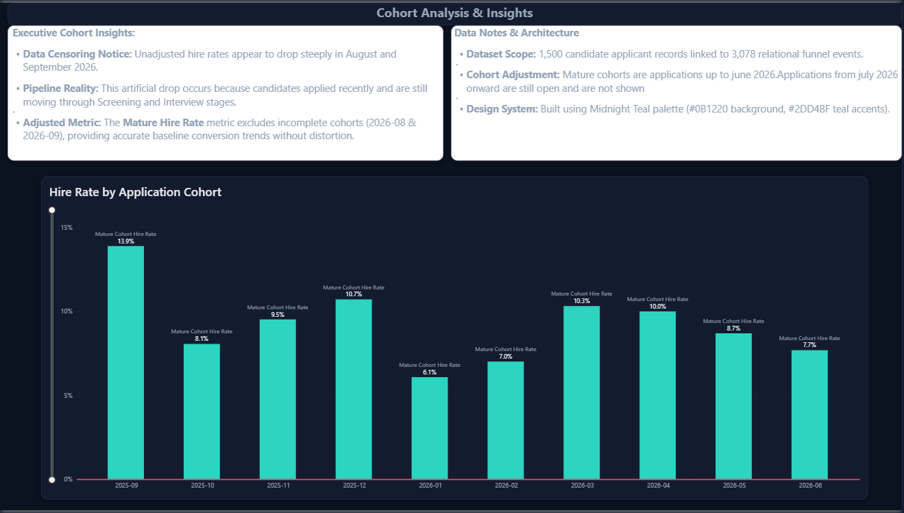
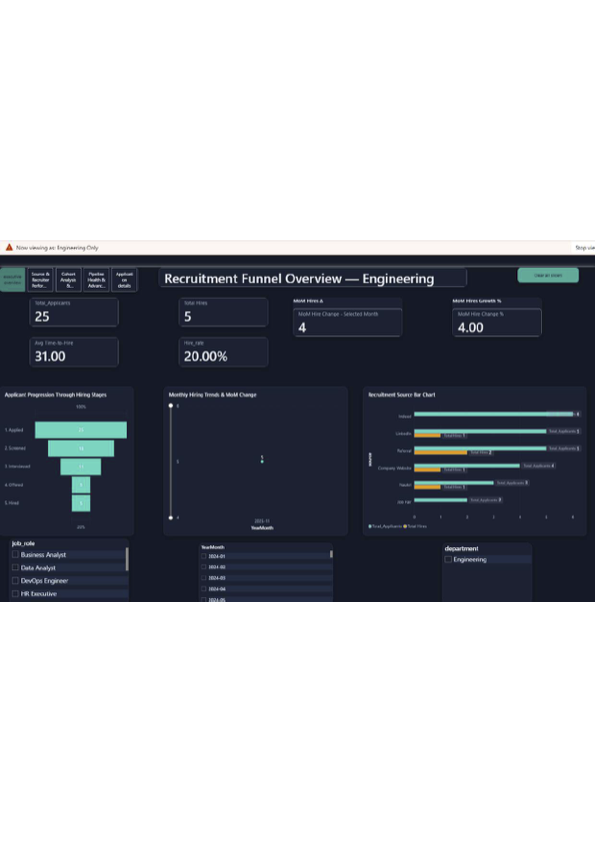

# Recruitment Funnel & Source-of-Hire Dashboard

*A people-analytics project by Abhay Pareek*

I built this project to answer two questions I kept asking while working with recruitment data: which sources actually bring in hires, and where do candidates drop out of the funnel? It started as messy Excel exports and grew into a small pipeline: SQLite for storage, Power BI and Streamlit for dashboards, and a few AI components that I tested properly instead of simply trusting them.

All data is synthetic. I generated 1,500 applicants for practice, so none of the numbers describe real hiring.

## The dashboards

### Streamlit app

Run `streamlit run app.py` and open https://recruitment-funnel-dashboard.streamlit.app/

**Overview.** Headline figures, the funnel, hire rate by source and monthly cohorts. Figures match the database.



**Fairness check.** Gender selection rates by stage with 95% intervals, adverse-impact ratios and Fisher tests. Synthetic data, see the fairness section below.



**Ask your funnel.** A plain-English question answered with a read-only SQL query. The SQL is shown with every answer.



**AI weekly brief.** Every figure is filled in by code and checked against the facts. The brief can still misstate comparisons (see Limitations).



### Power BI report

**Executive overview (all departments).** Headline figures, funnel, monthly trend and source bars.



**Source and recruiter performance.** Source benchmarks, time-to-hire by recruiter and the funnel drop-off waterfall.



**Pipeline health and advanced metrics.** In-process and rejected counts, stage reach and key drivers.



**Cohort analysis.** Hire rate by application month, using only mature cohorts (applied up to June 2026). Later months are excluded because their outcomes are still open.



**Row-level security.** The same report filtered to the Engineering department and one month, to show that the access rule works. Figures in this view are filtered, so they are not the totals.



---

## What I found

All figures come from `sql/recruitment.db`.

| Measure | Value |
|---|---|
| Applicants | 1,500 |
| Hired / rejected / still in process | 118 / 1,211 / 171 |
| Overall hire rate | 7.87% |
| Average days to hire (hires only) | 35.46 |
| Funnel: applied → screened → interviewed → offered → hired | 1,500 → 852 → 456 → 152 → 118 |
| Hire rate: Referral / LinkedIn / Job Fair | 19.52% (41 of 210) / 7.03% (27 of 384) / 2.65% (6 of 226) |
| Hire rate, applicants who applied up to June 2026 | 8.84% (101 of 1,142) |

Referrals convert best by a wide margin, and Job Fair has too few hires for its rate to mean much. I picked June 2026 as the cutoff for "mature" cohorts, which is my own choice. Later months still have candidates whose outcome is open, so their hire rates would look artificially low.

---

## How it's built

1. **Cleaning.** I started from messy source labels (`Linked in`, `JOBFAIR`, `Indeed ` with a trailing space) and mapped them to six canonical sources with a pandas dictionary. The dictionary is the original rule-based cleaning, and I kept it unchanged so I could compare against it later.
2. **Database.** The cleaned data loads into SQLite with `sql/load_data.py`. All the analysis reads it through a read-only connection.
3. **Dashboards.** Power BI for the report, Streamlit for the interactive app.
4. **AI components.** Four pieces, described below. Each one has offline tests, and I ran the live ones separately.

---

## Fairness check (AI #5)

I checked hire rates by gender at each stage of the funnel, with 95% Wilson intervals, Fisher exact tests, the 4/5ths screening ratio, and stratified views by source, department and experience.

| Hire rate | Female | Male | Impact ratio | Fisher p (hire) |
|---|---|---|---|---|
| All applicants | 5.77% (39 of 676) | 9.64% (75 of 778) | 0.60 | 0.0062 |
| Excluding In Process | 6.57% (39 of 594) | 10.85% (75 of 691) | 0.61 | 0.0077 |

Female applicants fall below the 0.80 threshold at every stage. Pooled odds ratios within source, department and experience band all point the same way, although individual subgroups do not. Indeed and Naukri show similar or higher female rates, for example.

I need to be clear about where this gap comes from. My synthetic generator (`notebook/recuitment_v2.ipynb`) sets the female conversion factor to 0.75 on purpose. So this analysis checks whether the method can detect an effect I planted. It says nothing about real hiring. A real adverse-impact review needs legal and domain expertise.

Non-binary applicants (46 people) are below the 50-person threshold I set, so I show their rates but never use them as a comparison group.

Walk-through notebook: `notebook/04_fairness_walkthrough.ipynb`. Full tables: `docs/fairness_report.md`.

---

## AI components and their live results

I used Groq's `openai/gpt-oss-20b` model for both live AI parts. Each row below is one run, and I've kept the failures in on purpose. Results vary between runs, so treat each number as one measurement.

### AI #1: label cleaning

I compared three approaches on hand-labelled source strings: the original dictionary, fuzzy matching, and an LLM. The full report is in `docs/ai_label_cleaning.md`. The main lesson was that the LLM handled messy variants well, but the test labels were written by an AI assistant, not by me, so that result needs an independent check.

### AI #3: ask your funnel (text-to-SQL)

The model proposes one read-only SQL query at a time, and my code checks each query before it runs. I tested it on 25 questions: answerable, ambiguous, unanswerable and adversarial.

| Run | Answerable | Ambiguous | Unanswerable | Adversarial | Notes |
|---|---|---|---|---|---|
| 1 (before fixes) | 12 of 15 (80.0%; 95% CI 54.8–93.0) | 3 of 3 | 2 of 3 | 4 of 4 | Three wrong answers: a fraction returned for a rate, a stage name that didn't match the data, and a status value in the wrong case. One request failed with a provider error. |
| 2 (after fixes) | 15 of 15 (100%; CI 79.6–100) | 3 of 3 | 3 of 3 (CI 43.8–100) | 4 of 4 (CI 51.0–100) | Average 2.0 steps, 26,771 tokens. |

The fixes were: giving the agent the real stored values of each category column, refusing forecast questions before any model call, and recording provider errors with their full message instead of crashing.

Two cautions. Run 2 is one run with 15 answerable questions, so the interval is wide. And the adversarial questions are caught by my rules before the model runs, so that column tests the rules, not the model.

### AI #2: weekly brief

I tried five designs. The first four failed validation; the fifth is the current one.

| Run | Design | Result |
|---|---|---|
| 1 | Model writes numbers and cites a fact ID after each one | Failed: 16 violations (wrong IDs, numbers with no citation) |
| 2 | Same design, stricter validator | Failed: 25 violations |
| 3 | Fact list with IDs added to the prompt | Passed on the first attempt. I didn't keep this run's text, only its result. |
| 4 | Narrative structure, same citation rules | Failed: 20 violations, mostly numbers joined to a citation that didn't cover them |
| 5 (current) | Model writes a template with `{FACT_ID}` placeholders; my code fills in every number | Passed on the second attempt. The first draft had one digit outside a placeholder. |

The current brief is in `docs/sample_brief.md`. The validator confirms that every number comes from a fact and that the model wrote no digits itself.

It does not confirm that each sentence uses the right fact. In run 5, one sentence describes the largest drop-off as Screened to Interviewed. The two figures it quotes (56.8% and 53.52%) are both correct, but they measure different steps, so the comparison is misleading. The validator passes it. That's a real limit of the design, and I'm planning a prompt change to address it.


## Quick start

```bash
python3 -m venv .venv
source .venv/bin/activate
python3 -m pip install -r requirements.txt
python3 sql/load_data.py
python3 -m unittest discover tests
python3 -m src.fairness.report
python3 notebook/make_fairness_notebook.py
python3 -m src.brief.run_brief
python3 tests/eval_agent.py
streamlit run app.py
```

If you already have a working `sql/recruitment.db`, copy it somewhere safe before running `sql/load_data.py`, because that script rebuilds the file.

## Repository layout

```
app.py                      Streamlit dashboard
sql/                        loader, queries, schema.md, recruitment.db (not committed)
datasets/raw/, processed/   source and cleaned data
datasets/label_eval/        AI #1 label sets, hashes, results
dashboard_screenshot/       dashboard screenshots
notebook/                   cleaning, AI #1 and AI #5 notebooks
power bi/                   Power BI report and theme
src/common/                 database connection, LLM wrapper with retry
src/label_mapping/          AI #1
src/brief/                  AI #2: facts pack, placeholder validator, brief generator, live runner
src/fairness/               AI #5: analysis and report
src/agent/                  AI #3: SQL guard, executor, agent loop
tests/                      offline tests, evaluation set, live evaluation runner
docs/                       AI #1 report, fairness report and tables, sample brief, run records
```

## Security and privacy

- Keys are read from `.env`, which is git-ignored. They are never printed, logged or written into notebooks or outputs.
- Only label strings (AI #1), aggregated facts (AI #2) and user questions with the schema (AI #3) go to the model. No applicant rows are sent.
- Gender is used only in the fairness analysis, never in a prompt.
- Recruiters are pseudonymous codes in the brief.

## Limitations

- All data is synthetic, so the results describe the generator as much as any real hiring.
- I wrote the AI #2 and AI #3 test cases, and the AI #1 test labels were written by an AI assistant. None of the test labels is from a real recruiter, so this is a real limit.
- The samples are small: 60 and 33 labels in AI #1, 46 Non-binary applicants in AI #5, and 15 answerable questions in AI #3.
- Live results are single runs, and a rerun may differ.
- The model's High/Medium/Low confidence labels are its own ratings, not calibrated probabilities.

## License

MIT. See `LICENSE`.

Abhay Pareek
